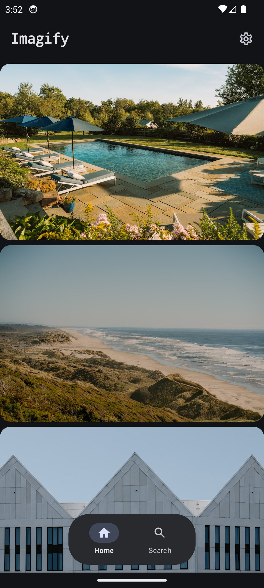
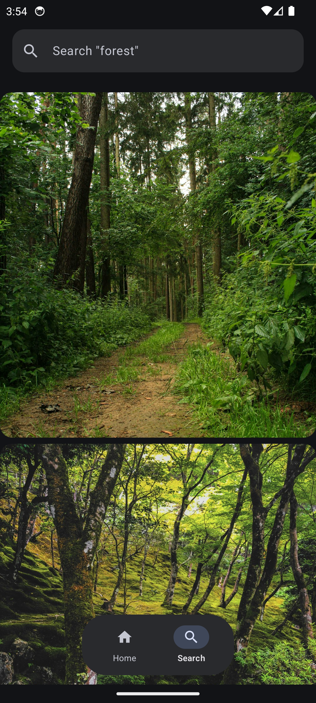
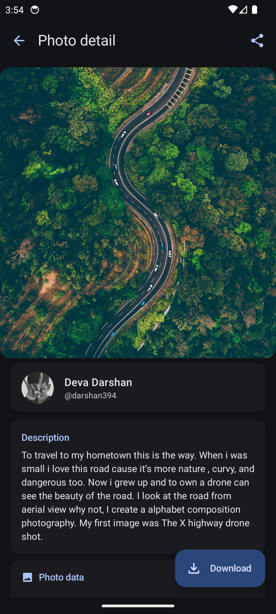
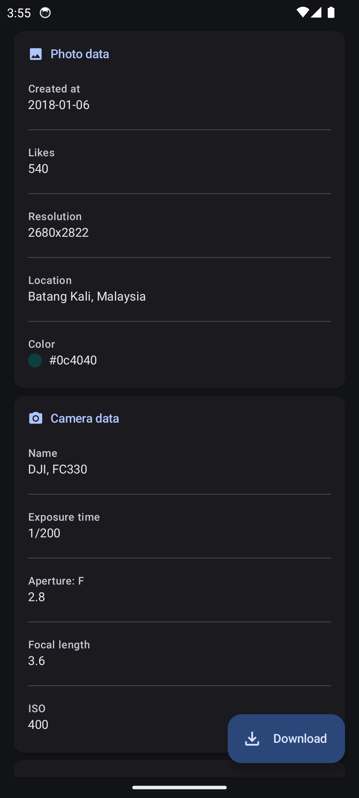

# Imagify

Imagify es una aplicación Android moderna para explorar, buscar y descargar fotos de Unsplash, diseñada con Jetpack Compose y arquitectura limpia. ¡Descubre imágenes increíbles y personaliza tu experiencia!

## Características principales

- 🖼️ Explora fotos editoriales y populares de Unsplash
- 🔍 Búsqueda avanzada por palabras clave y orientación
- 📥 Descarga imágenes directamente a tu dispositivo
- 🎨 Interfaz moderna con Material 3 y Jetpack Compose
- ⚡️ Carga rápida y caché inteligente con Coil
- 🔒 Preferencias de usuario y configuración personalizable
- 🔗 Detalles completos de cada foto y autor
- 🛡️ Integración con Firebase Crashlytics, Analytics y Performance

## Descargas

La última versión (v1.7.0) está disponible en [GitHub Releases](https://github.com/juanmadev5/Imagify/releases/latest).

## Screenshots

| Pantalla Principal | Búsqueda | Detalle de Imagen | Datos EXIF |
|--------------------|----------|--------------------|------------|
|  |  |  |  |

## Instalación y ejecución

1. **Clona el repositorio:**
	```sh
	git clone https://github.com/juanmadev5/Imagify.git
	```
2. **Abre el proyecto en Android Studio.**
3. **Configura tu clave de API de Unsplash:**
	- Agregá la línea `API_KEY=tu_api_key` a tu `local.properties` (no versionado). Se expone a la app como `BuildConfig.API_KEY`.
4. **Agrega tu `google-services.json` de Firebase:**
	- Creá un proyecto en [Firebase Console](https://console.firebase.google.com/), registrá la app con el namespace `com.jmdev.app.imagify` y descargá el archivo `google-services.json` generado.
	- Colocalo en `app/google-services.json` (el archivo no está versionado en el repo).
5. **Sincroniza dependencias y ejecuta en tu dispositivo/emulador.**

## Dependencias principales

- [Jetpack Compose](https://developer.android.com/jetpack/compose)
- [Koin](https://insert-koin.io/)
- [Retrofit](https://square.github.io/retrofit/)
- [Coil](https://coil-kt.github.io/coil/)
- [Firebase Crashlytics, Analytics, Perf](https://firebase.google.com/)
- [Paging 3](https://developer.android.com/topic/libraries/architecture/paging)

## Estructura del proyecto

```
Imagify/
├── app/
│   ├── src/
│   │   ├── main/
│   │   │   ├── java/com/jmdev/app/imagify/
│   │   │   │   ├── data/
│   │   │   │   │   ├── paging/      # PagingSource de Home y Búsqueda
│   │   │   │   │   ├── remote/      # API, interceptores
│   │   │   │   │   ├── repository/  # Implementación de repositorios
│   │   │   │   ├── domain/
│   │   │   │   │   ├── repository/  # Contratos de repositorios
│   │   │   │   │   ├── usecase/     # Casos de uso
│   │   │   │   ├── di/              # Inyección de dependencias (Koin)
│   │   │   │   ├── model/           # Modelos de dominio
│   │   │   │   ├── presentation/    # UI y pantallas (Compose)
│   │   │   │   ├── utils/           # Utilidades
│   │   │   ├── res/                 # Recursos gráficos y strings
│   ├── build.gradle.kts
├── assets/                      # Screenshots
├── README.md
```

## 🧪 Pruebas y calidad del código
Imagify incluye pruebas unitarias que validan la configuración base de la aplicación, la integración de dependencias con Koin y Coil, la lógica de los casos de uso del dominio, y el comportamiento de los `StateFlow` expuestos por los ViewModels.

Los tests viven en:
```
app/src/test/java/com/jmdev/app/imagify/
├── AppTest.kt
├── domain/usecase/
│   ├── DownloadPhotoUseCaseTest.kt
│   ├── GetPhotoUseCaseTest.kt
│   ├── GetUserPreferencesUseCaseTest.kt
│   ├── GetUserProfileUseCaseTest.kt
│   ├── SaveOrientationUseCaseTest.kt
│   └── SaveQualityUseCaseTest.kt
├── presentation/screens/
│   ├── imageDetailScreen/ImageDetailViewModelTest.kt
│   ├── mainScreen/MainScreenViewModelTest.kt
│   └── settingsScreen/SettingsViewModelTest.kt
```
Qué se prueba:

- ✅ Verificación de módulos de Koin (`appModule.verify()`)
- ✅ Políticas de caché (memoria, disco, red) de las requests de imágenes armadas con `buildImageRequest`
- ✅ Casos de uso del dominio (`GetPhotoUseCase`, `GetUserProfileUseCase`, `GetUserPreferencesUseCase`, `SaveOrientationUseCase`, `SaveQualityUseCase`, `DownloadPhotoUseCase`), mockeando los repositorios con Mockito
- ✅ Los `StateFlow` de `MainScreenViewModel`, `ImageDetailViewModel` y `SettingsViewModel` (carga de preferencias, eventos de UI, estados de descarga), usando [Turbine](https://github.com/cashapp/turbine)

Para correrlos:
```sh
./gradlew testDebugUnitTest
```

Análisis estático (debe pasar limpio antes de dar por terminado un cambio):
```sh
./gradlew lint
./gradlew detekt
```
`detekt` usa un baseline (`app/config/detekt/baseline.xml`) para no re-señalar deuda de estilo preexistente; un cambio nuevo debe seguir pasando sin agregar hallazgos.

## Créditos y agradecimientos

- Fotos proporcionadas por [Unsplash](https://unsplash.com/)
- Iconos de [Material Icons](https://fonts.google.com/icons)
- Desarrollado por [@juanmadev5](https://github.com/juanmadev5)

---

¡Contribuciones y sugerencias son bienvenidas! ⭐

